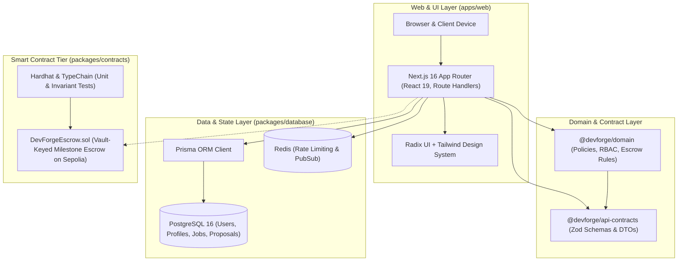

# DevForge

> A prototype marketplace for technical freelance work, with a Sepolia-only escrow experiment.

[Live application](https://devforge-web-8bv4.vercel.app/) · [Architecture](docs/ARCHITECTURE.md) · [Product requirements](docs/PRD.md) · [Roadmap](docs/ROADMAP.md) · [Contributing](CONTRIBUTING.md)

## What it does

DevForge is an early-stage prototype for clients and technical specialists to explore project listings, proposals, and milestone workflows. It is not a production marketplace or payment service.

- Browse job listings and sample marketplace data.
- Create email/password accounts with database-backed sessions.
- Explore proposal, project, and milestone workflows that are still under development.
- Connect a browser wallet for address/network display; wallet connection does not sign in or authorize an account.

> **Prototype warning:** Escrow, payment release, arbitration, OAuth, and wallet-based authentication are not production-ready. Do not send real funds or use this application for real engagements.

## Architecture



The monorepo enforces unidirectional dependencies:

- **`apps/web`**: Next.js application, responsive UI, accessible dialogs, and route handlers.
- **`packages/domain`**: Framework-agnostic business policies (RBAC, escrow lifecycle, proposal state transitions).
- **`packages/api-contracts`**: Strongly-typed Zod schemas and API request/response contracts.
- **`packages/database`**: Prisma ORM schema, migration history, seed scripts, and PostgreSQL client.
- **`packages/contracts`**: Solidity smart contracts (`DevForgeEscrow.sol`), Hardhat test suite, and deployment tooling.
- **`packages/observability`**: Structured logging and error instrumentation.

See the [architecture guide](docs/ARCHITECTURE.md) for deeper design details.

## Recruiter & Evaluator Quick Demo Access

For testing live marketplace workflows without manual registration, pre-seeded accounts and one-click quick-fill buttons are provided directly on the [Sign In page](https://devforge-web-8bv4.vercel.app/auth/sign-in):

| Persona                            | Role                      | Email                         | Password       | Primary Workflow                                           |
| :--------------------------------- | :------------------------ | :---------------------------- | :------------- | :--------------------------------------------------------- |
| **Elena Rostova** (`satoshi_core`) | Specialist (`freelancer`) | `specialist@devforge.network` | `Password123!` | Submit deliverables, browse bounties, track milestone bids |
| **DevForge Labs**                  | Protocol Lead (`client`)  | `client@devforge.network`     | `Password123!` | Create technical jobs, review deliverables, release escrow |

## Smart Contracts & Escrow Protocol

The milestone escrow engine is located in [`packages/contracts`](packages/contracts).

- **Deterministic Vault Keys**: `keccak256(abi.encodePacked(contractId, milestoneIndex))` guarantees vault isolation per milestone.
- **Security**: Strict Checks-Effects-Interactions (CEI) state machine, OpenZeppelin `ReentrancyGuard`, and multi-party arbitration support.
- **Commands**:
  - Compile & TypeChain: `pnpm --filter @devforge/contracts compile`
  - Run Contract Tests: `pnpm --filter @devforge/contracts test`
  - Deploy to Sepolia: `npx hardhat run scripts/deploy.ts --network sepolia`
  - Verify on Etherscan: `npx hardhat verify --network sepolia <ADDRESS> "<OWNER>"`

## Stack

- **Application:** Next.js 16, React 19, TypeScript, Tailwind CSS, Radix UI
- **Data:** PostgreSQL 16, Prisma, Redis
- **Identity:** Argon2 password hashing and opaque database-backed sessions
- **Contracts:** Solidity, Hardhat, TypeChain
- **Tooling:** pnpm 11, Vitest, ESLint, Prettier

## Local development

### Prerequisites

- Node.js 22+
- pnpm 11+
- Docker Desktop
- Git

### Setup

```bash
git clone https://github.com/Mohitgharate10/devforge.git
cd devforge
```

On Windows PowerShell, create the Prisma environment file with:

```powershell
if (!(Test-Path .env)) { Copy-Item .env.example .env }
```

On macOS/Linux:

```bash
cp .env.example .env
```

Then start the local services, apply the database migrations, and seed development data:

```bash
docker compose -f docker/compose.yml up -d
pnpm install
pnpm db:migrate:deploy
pnpm db:seed
pnpm dev
```

Open [http://localhost:3000](http://localhost:3000). The health endpoint is available at `/api/v1/health`.

Prisma reads `DATABASE_URL` and `DIRECT_URL` from `.env`; keep this file local and never commit it. The example uses local Docker credentials and must not be used in production. Replace all development secrets before deployment, and configure optional OAuth values only when the relevant provider is enabled.

## Common commands

| Command                                  | Purpose                                  |
| ---------------------------------------- | ---------------------------------------- |
| `pnpm dev`                               | Run the web application locally          |
| `pnpm build`                             | Build the web app and workspace packages |
| `pnpm check`                             | Run format, lint, type, and test checks  |
| `pnpm test`                              | Run workspace tests                      |
| `pnpm test:e2e`                          | Run Playwright end-to-end tests          |
| `pnpm lint` / `pnpm typecheck`           | Run static checks                        |
| `pnpm db:migrate:dev`                    | Create and apply development migrations  |
| `pnpm db:migrate:deploy`                 | Apply production migrations              |
| `pnpm db:seed`                           | Seed local development data              |
| `pnpm --filter @devforge/contracts test` | Run contract tests                       |

## Contributing

Please read [CONTRIBUTING.md](CONTRIBUTING.md) before opening an issue or pull request. For meaningful changes, include tests and run `pnpm check` locally.

## License

Licensed under the [MIT License](LICENSE).
