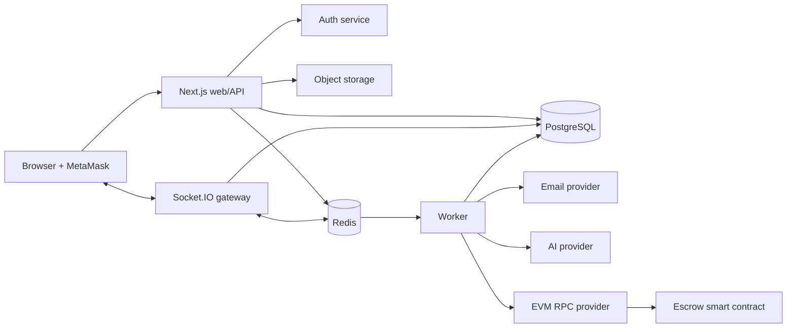
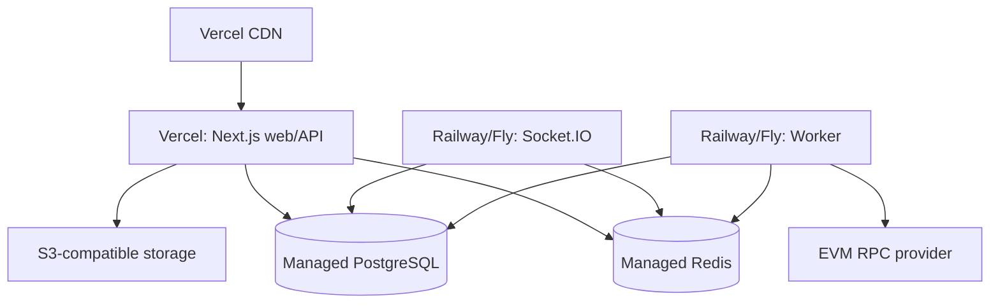

# DevForge Architecture

> **Status:** This document describes the intended architecture, not a guarantee that every component is implemented or deployed. The current prototype uses email/password authentication with opaque database-backed sessions. Wallet-based sign-in, OAuth, production escrow, and several separately described services are not production-ready.

## 1. Architectural principles

DevForge is a **modular monolith with separable edge services**. The application starts with one deployable web/API product to preserve delivery speed and transactional consistency, while realtime, background processing, and contracts have independent runtime boundaries because they have different scaling and reliability needs.

The architecture favors explicit domain modules, stateless application services, PostgreSQL as the application system of record, and asynchronous integration for slow or externally sourced work.

## 2. Monorepo structure

```text
devforge/
├─ apps/
│  ├─ web/             Next.js App Router UI and REST API
│  ├─ realtime/        Socket.IO gateway
│  └─ worker/          Queue consumers and scheduled reconciliation
├─ packages/
│  ├─ api-contracts/   Zod schemas and API DTO types
│  ├─ database/        Prisma schema, migrations, generated client (future)
│  ├─ domain/          Entities, value objects, policies, use-case interfaces
│  ├─ contracts/       Solidity, Hardhat, ABI/type generation, deployments
│  ├─ ui/              Shared accessible design primitives
│  ├─ config/          Shared TypeScript, lint, test, Tailwind configuration
│  └─ observability/   Logging, tracing, metrics, error reporting adapters
├─ tests/              Cross-application integration and end-to-end suites
├─ docker/             Local development runtime definitions
└─ docs/               Product and engineering decisions
```

`apps/web` owns HTTP rendering and API composition, not business rules. `packages/domain` owns business semantics and use-case contracts. `packages/database` contains persistence concerns only. This separation permits later extraction of a module without first untangling UI, routes, and database access.

## 3. Apps and package responsibilities

| Component       | Responsibility                                                                                 | Why                                                                           |
| --------------- | ---------------------------------------------------------------------------------------------- | ----------------------------------------------------------------------------- |
| `apps/web`      | Next.js pages, server components, route handlers, BFF composition, authentication edge checks  | Delivers one coherent web product with SSR and REST endpoints.                |
| `apps/realtime` | Authenticated Socket.IO connections, rooms, presence, transient events                         | Long-lived connections scale and fail differently from request/response APIs. |
| `apps/worker`   | Queues, email, notification fan-out, attachment processing, AI jobs, blockchain reconciliation | Retries and slow work must not occupy user-facing request capacity.           |
| `api-contracts` | Versioned Zod request/response contracts                                                       | Prevents drift between UI, handlers, and services.                            |
| `domain`        | Domain policies, DTOs, interfaces, application use cases                                       | Keeps business rules testable and framework-independent.                      |
| `database`      | Database schema, migrations, repositories, transaction factory                                 | Makes PostgreSQL/Prisma an implementation detail at domain boundaries.        |
| `contracts`     | Escrow source, tests, deployment artifacts, ABI                                                | Isolates security-critical blockchain code and its toolchain.                 |

## 4. Module boundaries

The web and worker applications compose the same modules: identity, profiles, marketplace, proposals, projects, escrow, messaging, notifications, reviews, moderation, and AI. A module exposes application use cases and repository interfaces; other modules depend on those public contracts, never on another module's tables.

## 5. System diagram



Every persistent user action flows through the REST API and PostgreSQL. Socket.IO only broadcasts events after persistence succeeds. The worker handles retryable external work. This prevents an ephemeral connection or provider outage from becoming the record of business state.

## 6. Service communication

- Browser-to-web: HTTPS JSON REST endpoints; typed contracts; secure cookies.
- Browser-to-realtime: Socket.IO over WSS, authenticated during handshake using a short-lived service token.
- Web/worker-to-PostgreSQL: repository interfaces and transactions.
- Web/worker/realtime-to-Redis: queues, distributed rate limits, pub/sub, transient presence.
- Worker-to-external providers: verified, time-bounded requests with retry policy and idempotency keys.
- Worker-to-chain: read/write RPC interaction; event logs are persisted and deduplicated before state transitions.

No internal service calls are trusted merely because they are internal: every message carries a schema version, correlation ID, actor/context where appropriate, and idempotency key for mutating external operations.

## 7. Authentication flow

```mermaid
sequenceDiagram
  participant B as Browser
  participant W as Web/API
  participant D as PostgreSQL
  B->>W: Email/Google sign-in
  W->>D: Verify identity; create session
  W-->>B: Secure HttpOnly session cookie
  B->>W: Request protected resource
  W->>D: Resolve session and user
  W-->>B: Authorized response
```

The current application verifies email/password credentials and stores a hash of a random session token in PostgreSQL. The browser receives the raw token only in an `HttpOnly`, `SameSite=Lax` cookie, marked `Secure` in production. OAuth and wallet-based sign-in are not currently available.

The wallet control only connects to a browser wallet and displays its address/network; it does not authenticate an account or authorize application actions.

## 8. Authorization flow

Authentication establishes the actor. Authorization evaluates both role and resource policy at the use-case boundary.

```text
request → session actor → route permission gate → input validation
        → use-case policy (ownership/membership/state) → repository operation
```

Examples: only a job's owning client can edit it; only project members can read its conversation; only the client may fund/release its milestone; an administrator needs an explicit permission and an audit reason for moderation actions. Roles accelerate coarse checks but never replace ownership/membership checks.

## 9. Request lifecycle

1. Edge middleware applies security headers, request IDs, coarse rate limits, and route classification.
2. A route handler resolves the authenticated actor where required.
3. A Zod contract parses and validates request parameters/body.
4. The handler calls one application use case; it contains authorization and state-transition logic.
5. Repositories execute parameterized database queries inside a transaction where an operation spans records.
6. The response mapper returns the versioned API envelope; side effects enter an outbox/queue after commit.
7. Structured logs capture outcome, duration, actor type, route, and correlation ID without secrets or message/file content.

This makes API endpoints adapters rather than a second home for business rules.

## 10. Error handling and logging

Domain errors are typed (`VALIDATION_FAILED`, `UNAUTHENTICATED`, `FORBIDDEN`, `NOT_FOUND`, `CONFLICT`, `STATE_TRANSITION_INVALID`, `RATE_LIMITED`, `EXTERNAL_DEPENDENCY_FAILED`). A single mapper converts them into stable HTTP status codes and safe client messages. Unexpected failures return `INTERNAL_ERROR` with a request ID; implementation details remain in logs.

Use JSON structured logs with timestamp, level, service, environment, request/job ID, correlation ID, actor ID when safe, and error cause. Never log passwords, session tokens, wallet signatures, raw AI prompts containing sensitive content, or signed upload URLs. Send errors/traces to a dedicated observability provider and keep audit logging separate from operational logging.

## 11. Deployment architecture



Vercel is selected for the Next.js application because it aligns with the framework's rendering and deployment model. Realtime and worker workloads deploy separately to a container-friendly runtime because they need persistent connections, consumer concurrency, explicit process lifecycle, and controlled retry behavior. PostgreSQL, Redis, object storage, email, AI, and RPC providers are managed services to reduce operational burden during product validation.

CI builds, lints, typechecks, tests, scans dependencies, runs contract tests, and packages deployable artifacts. Production deploys require migration review, environment validation, health checks, monitoring, and rollback paths.

## 12. Background workers

Workers consume named queues: `notifications`, `email`, `uploads`, `ai`, `escrow-events`, `escrow-reconciliation`, and `outbox`. Jobs carry idempotency keys and bounded retry/backoff policies. Failed work is visible in a dead-letter workflow; retry exhaustion raises an alert. Outbox events are written in the same database transaction as the source state change, avoiding lost events between a successful API response and an attempted enqueue.

## 13. Realtime architecture

The Socket.IO gateway authenticates each connection, authorizes room joins against project/conversation membership, and uses Redis pub/sub for multi-instance delivery. Durable messages are created through the API or a shared command service before broadcast. Presence, typing, and connection state are ephemeral Redis data and are never treated as proof of message delivery.

Clients reconnect with backoff and resynchronize from the REST message cursor, which prevents data loss after a gateway restart or missed event.

## 14. AI architecture

AI requests are authenticated, rate-limited, permission checked, and persisted as auditable request records. The web API creates a queued job; the worker loads minimal approved context, invokes the provider through an adapter, validates structured output, stores a draft, and notifies the user. AI output is labeled as generated, requires user review/editing before publication, and cannot initiate hiring, change permissions, or release funds.

An adapter isolates provider APIs, supports model changes, records token/cost metadata, and enables later evaluation tests. This prevents AI vendor lock-in and makes cost/safety controls explicit.

## 15. Web3 architecture

`packages/contracts` contains an intentionally narrow milestone escrow contract using established audited primitives. Client wallet transactions fund and release escrow; DevForge never controls private keys. Contract events are indexed by the worker with finality confirmations, unique `(chainId, txHash, logIndex)` deduplication, and a reconciliation checkpoint.

PostgreSQL records the user-facing escrow projection; emitted, confirmed chain events are authoritative for settlement. If the API and chain disagree, the escrow is marked for reconciliation instead of guessing. Contract upgrades or mainnet releases require a separate security review, threat model, test suite, and deployment runbook.
